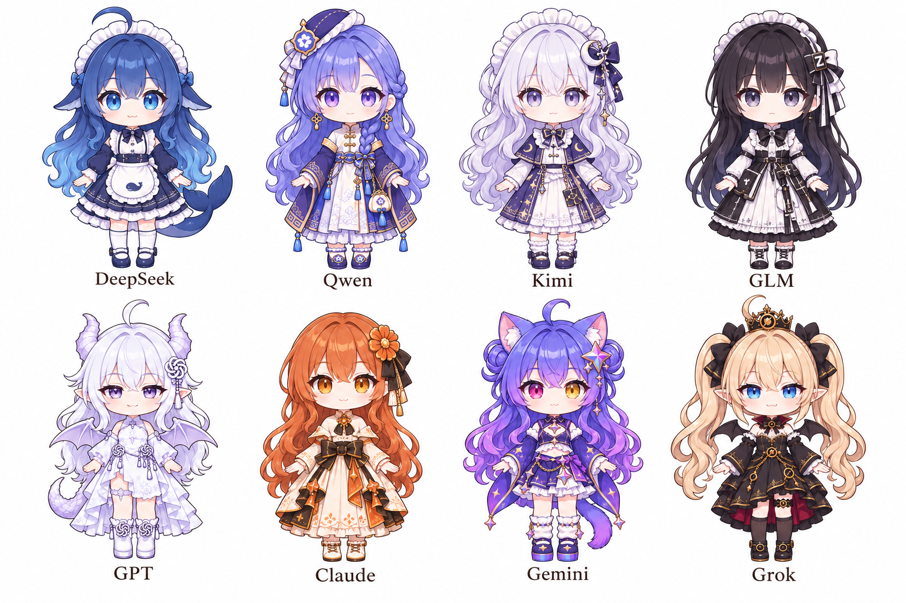
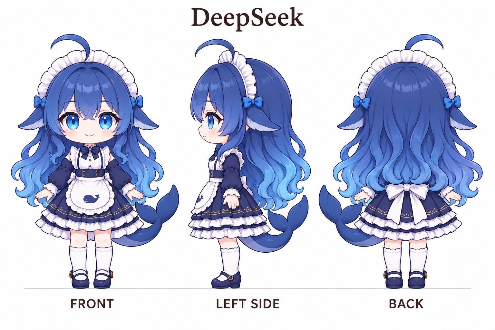
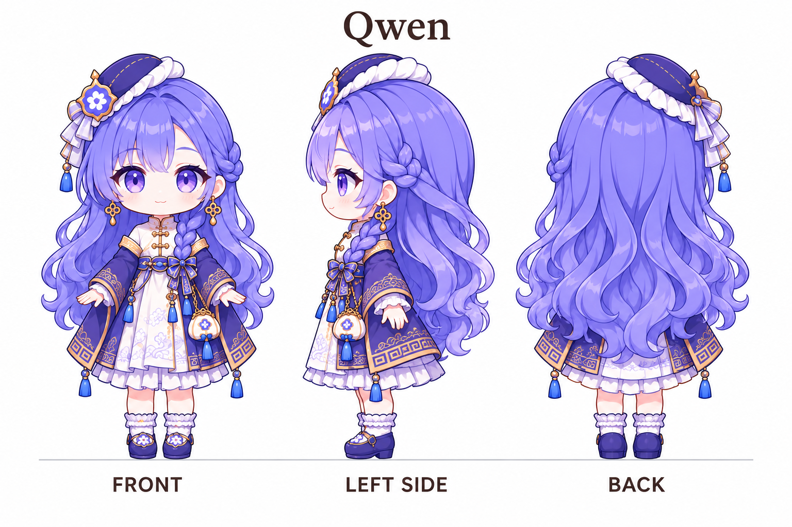
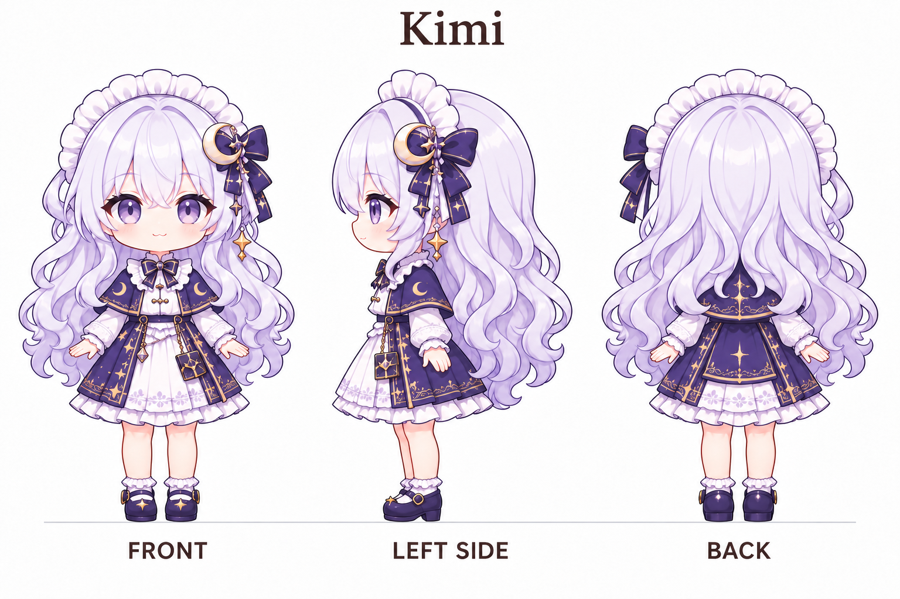
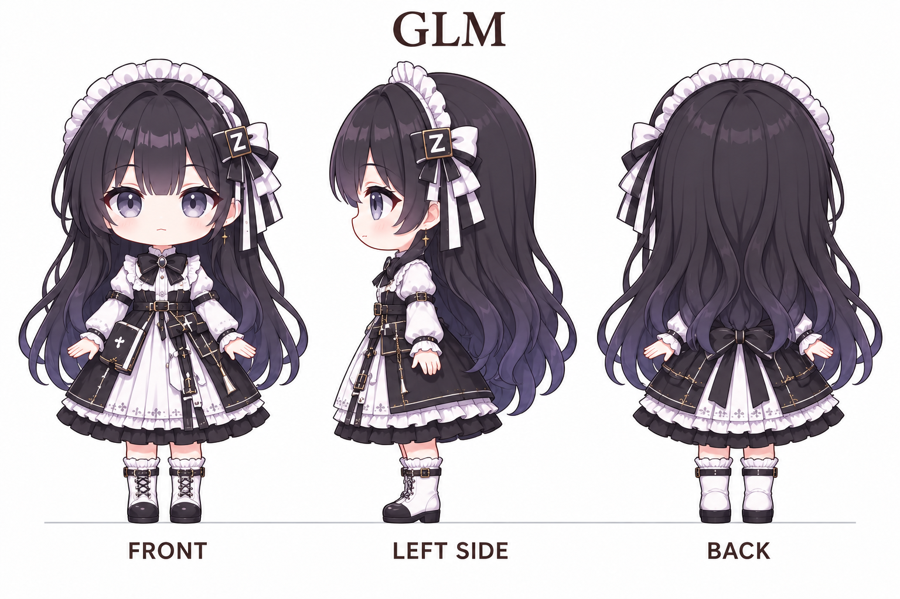
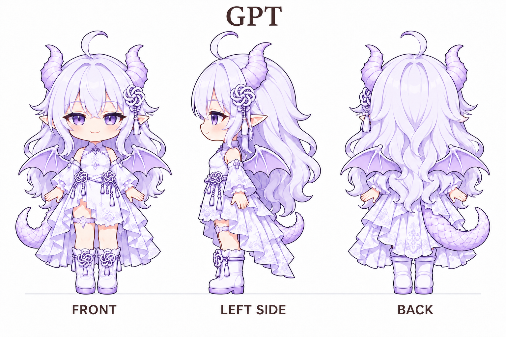
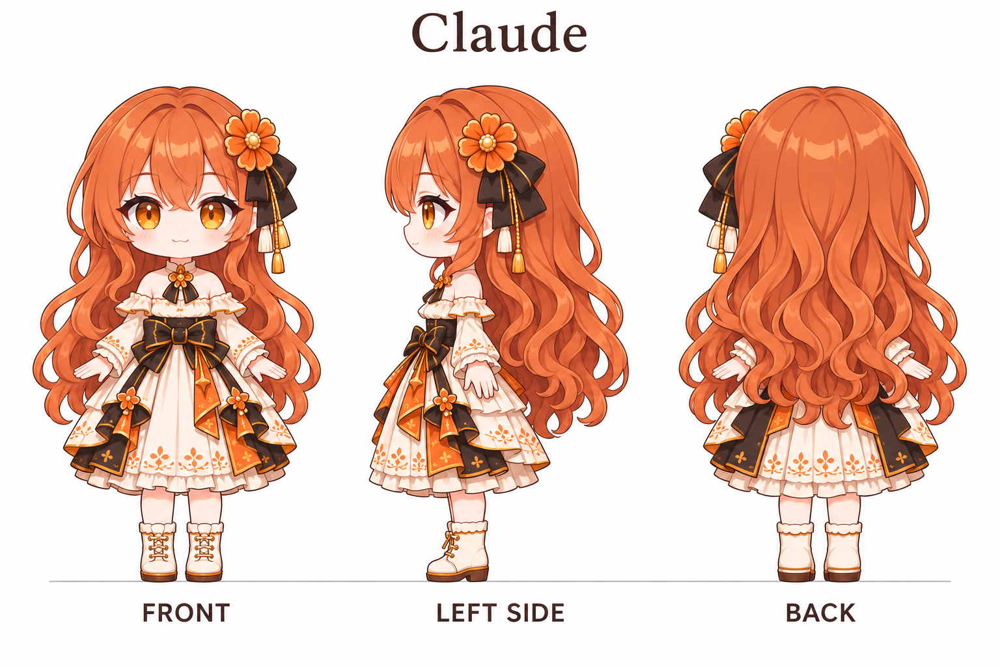
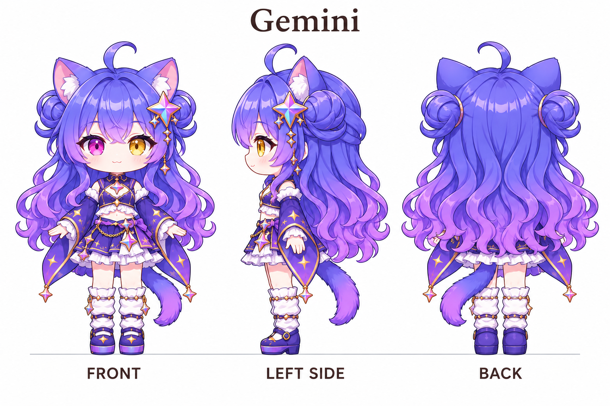
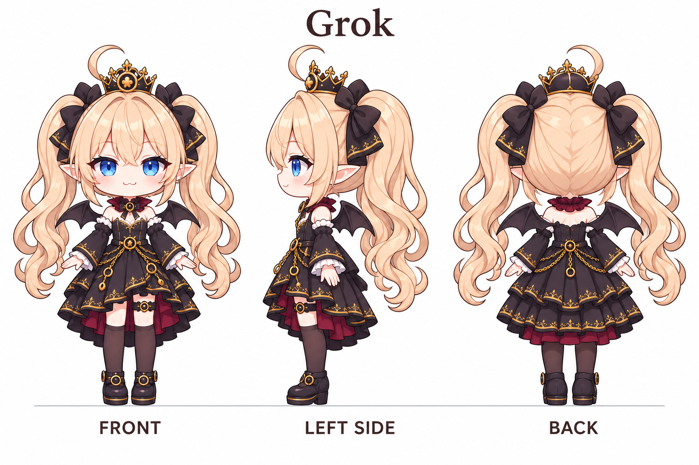
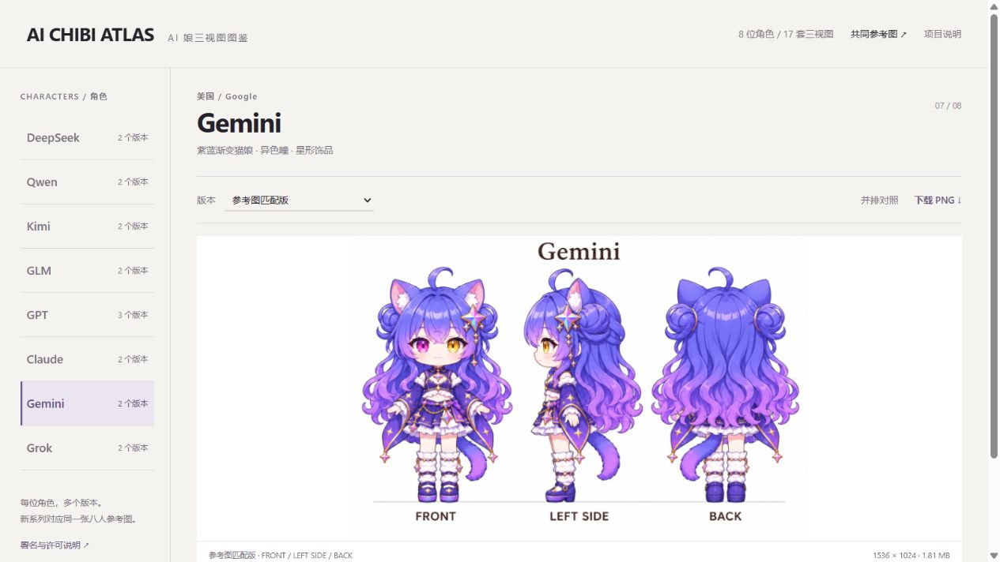

# AI Chibi Atlas · AI 娘三视图图鉴

8 位女性 Q 版 AI 拟人角色，17 套三视图。每位角色独立归档，保留多个衣装／表情版本；当前主系列根据同一张八人参考图制作。

*A multi-version fan character turnaround collection: 8 AI characters, 17 sheets, front / left side / back.*

[角色图鉴](#角色图鉴) · [制作记录](docs/WORKFLOW.md) · [来源署名](ATTRIBUTION.md) · [图片许可](ASSET-LICENSES.md) · [上传与展示](docs/PUBLISHING.md)



## 本次主系列

`v2-dance` 对应上方参考图的发型、服装与闭嘴小表情，每位角色均有匹配的正面、左侧面和背面。新系列统一为 **1536 × 1024 PNG**，共八套；此前九套图以历史版本保留。豆包／Seed 未收录。

图片为同人设计参考与 AI 衍生补全，隐藏结构包含推定。许可按来源分别记录，不能把整套图片理解为 MIT 可商用素材。

## 角色图鉴

点击图片进入该角色文件夹，可浏览全部版本。

<table>
<tr><td align="center"><a href="characters/deepseek/"></a><br><b>DeepSeek</b> · 2 个版本<br><a href="characters/deepseek/">角色档案</a> · <a href="characters/deepseek/variants/v2-dance/sheet.png">完整 PNG</a></td><td align="center"><a href="characters/qwen/"></a><br><b>通义千问 Qwen</b> · 2 个版本<br><a href="characters/qwen/">角色档案</a> · <a href="characters/qwen/variants/v2-dance/sheet.png">完整 PNG</a></td></tr>
<tr><td align="center"><a href="characters/kimi/"></a><br><b>Kimi</b> · 2 个版本<br><a href="characters/kimi/">角色档案</a> · <a href="characters/kimi/variants/v2-dance/sheet.png">完整 PNG</a></td><td align="center"><a href="characters/glm/"></a><br><b>智谱 GLM</b> · 2 个版本<br><a href="characters/glm/">角色档案</a> · <a href="characters/glm/variants/v2-dance/sheet.png">完整 PNG</a></td></tr>
<tr><td align="center"><a href="characters/gpt/"></a><br><b>ChatGPT / GPT</b> · 3 个版本<br><a href="characters/gpt/">角色档案</a> · <a href="characters/gpt/variants/v2-dance/sheet.png">完整 PNG</a></td><td align="center"><a href="characters/claude/"></a><br><b>Claude</b> · 2 个版本<br><a href="characters/claude/">角色档案</a> · <a href="characters/claude/variants/v2-dance/sheet.png">完整 PNG</a></td></tr>
<tr><td align="center"><a href="characters/gemini/"></a><br><b>Gemini</b> · 2 个版本<br><a href="characters/gemini/">角色档案</a> · <a href="characters/gemini/variants/v2-dance/sheet.png">完整 PNG</a></td><td align="center"><a href="characters/grok/"></a><br><b>Grok</b> · 2 个版本<br><a href="characters/grok/">角色档案</a> · <a href="characters/grok/variants/v2-dance/sheet.png">完整 PNG</a></td></tr>
</table>

## 版本与目录

- `v1-initial`：八位角色的初版。保留原始文件字节。
- `v1-natural-smile`：GPT 初版的自然微笑修订。
- `v2-dance`：八位角色按共同参考图制作的新系列，默认展示。

```text
characters/
  deepseek/
    README.md
    provenance.json
    references/author-video-frame.png
    variants/
      v1-initial/sheet.png
      v2-dance/
        sheet.png
        prompt.txt
        generation.json
  qwen/  kimi/  glm/  gpt/  claude/  gemini/  grok/
references/dance-reference-board.png
catalog.json
index.html
scripts/
docs/
```

每张图在 `catalog.json` 中登记尺寸、字节数、SHA-256、版本和来源。新图的完整提示词与修正记录随各版本保存；具体模型版本未由内置工具提供，因此未猜测填写。

## 浏览与检查

下载后双击 [index.html](index.html)，可切换角色、版本，与初版并排对照，并查看共同参考图。页面支持离线使用，也可放到 GitHub Pages；见 [发布说明](docs/PUBLISHING.md)。

```bash
python scripts/build_gallery.py
python scripts/verify.py
```



自动检查图像完整性、元数据与本地链接；美术一致性检查记录在 [QUALITY.md](docs/QUALITY.md)。GitHub Actions 会运行同样的校验。

## 来源与许可

角色设计主要参考 ZipZipPipe 系列，DeepSeek 原型另需署名上善无形。社区三视图、AI 衍生版本与作者视频截帧分别记录，均不是厂商官方角色。

- [ai-girls](https://github.com/shuaizenge/ai-girls)：角色画面参考与 DeepSeek 社区三视图。
- [ai-chan-sheets](https://github.com/lmy414/ai-chan-sheets)：GPT 白紫龙娘社区三视图。
- [蓝色大肥鱼角色百科](https://xn--pssy23gqgbz2d718b.com/characters.html)：角色与作品来源交叉核对。
- [疚刃《若不是你突然闯进我生活》](https://www.bilibili.com/video/BV16Vap6yEGP/)：基础神态与舞蹈表现方向参考。

DeepSeek 设计含非商业与相同方式共享要求；GPT 变体的原作者与授权未明；其余条目保留上游的分享／再创作说明，不擅自补成统一标准许可证。详情见 [署名](ATTRIBUTION.md)、[图片许可](ASSET-LICENSES.md) 和逐角色 provenance.json。代码的 MIT 许可不涵盖图片或角色权利。
