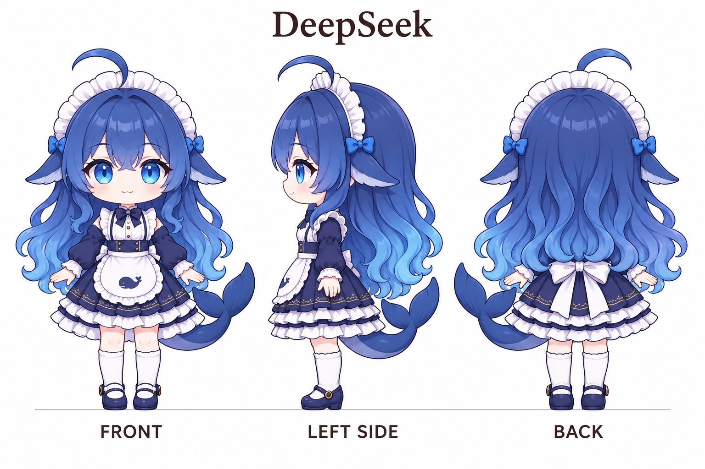

# DeepSeek

蓝发鲸鱼娘 · 女仆装 · 天真小笑。所属模型／产品：DeepSeek；社区女性拟人形象。

## 版本

| 版本 | 图像尺寸 | PNG |
| --- | --- | --- |
| [初版](variants/v1-initial/) | 1774 × 887 | [v1-initial](variants/v1-initial/sheet.png) |
| [参考图匹配版](variants/v2-dance/) | 1536 × 1024 | [v2-dance](variants/v2-dance/sheet.png) |

当前默认版本为 **参考图匹配版**，依据 [八人参考图](../../references/dance-reference-board.png) 中的 TOP ROW, FIRST column。各版本并列保留；形象、服装与表情可有差异。

## 来源与署名

原型：上善无形；女仆二次设计：ZipZipPipe；三视图绘制者待核实。

[素材来源](https://github.com/shuaizenge/ai-girls/tree/main/characters/deepseek) · [原始发布／整理来源](https://aigengtu.com/refs) · [逐项记录](provenance.json)

许可记录：角色二次设计 CC BY-NC-SA 4.0；社区三视图文件具体绘制者与授权待核实。

当前系列使用内置 imagegen 参照补全，正／侧／背顺序一致；侧背面不可见结构为推定。图片许可不随代码 MIT 许可变更。详见 [图片许可](../../ASSET-LICENSES.md)。

[返回图鉴](../../README.md) · [在画廊浏览](../../index.html#deepseek/v2-dance)
