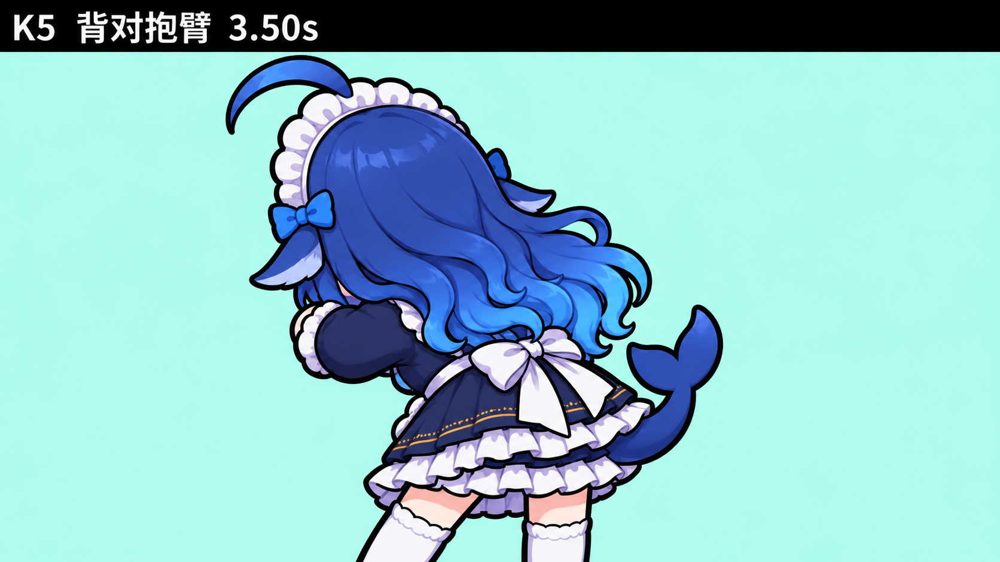
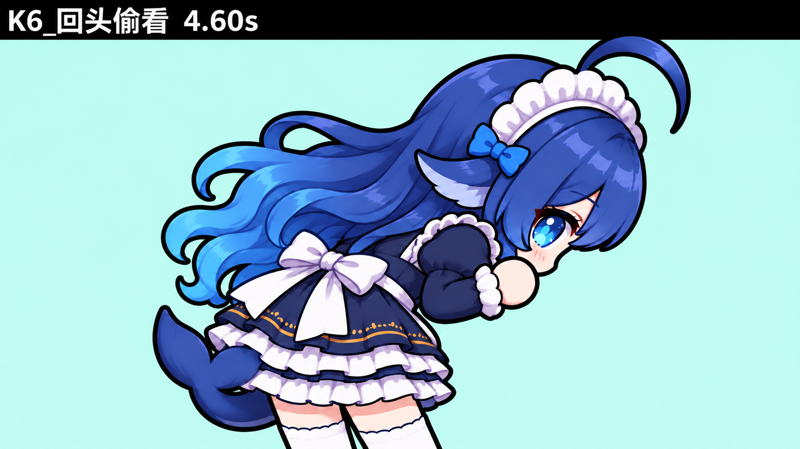
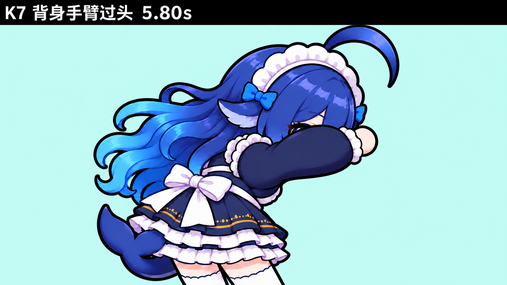

# DeepSeek · 七张独立关键帧

每次只生成一帧，再与原版对应动作进行视觉对照。使用内置 imagegen，保留各帧提示词、局部修正记录与检查说明。

| 帧 | 时间 | PNG | 动作重点 |
| --- | --- | --- | --- |
| K1 | 0.00s | [K1.png](K1.png) | 近手更大更低，远手后收 |
| K2 | 1.00s | [K2.png](K2.png) | 近拳高、远手低，身体侧倾 |
| K3 | 1.80s | [K3.png](K3.png) | 腰胯右偏，远拳大半被头遮挡 |
| K4 | 2.20s | [K4.png](K4.png) | 相反视角，近右拳高、远左拳低 |
| K5 | 3.50s | [K5.png](K5.png) | 前倾与臀胯后移，腿不交叉 |
| K6 | 4.60s | [K6.png](K6.png) | 背身前倾，只露一只眼 |
| K7 | 5.80s | [K7.png](K7.png) | 前臂遮脸，仅露极少眼部 |

6.90s 回到 K1。沿用原参考至大腿附近的裁切，脚部不在画面内；K3／K4 保持腿向下，以腰胯转动和视角变化表现动作，K5 不抬腿、不交叉。

K1 保留用户认可母版的原始字节。其余动作在同一形象基础上分别生成。

## K1 · 0.00s

1594 × 987 PNG · [制作与目视检查记录](K1.generation.json)

[K1.prompt.txt](K1.prompt.txt)

## K2 · 1.00s

1672 × 941 PNG · [制作与目视检查记录](K2.generation.json)

[K2.prompt.txt](K2.prompt.txt) · [K2.refinement.prompt.txt](K2.refinement.prompt.txt)

## K3 · 1.80s

1672 × 941 PNG · [制作与目视检查记录](K3.generation.json)

[K3.prompt.txt](K3.prompt.txt)

## K4 · 2.20s

1672 × 941 PNG · [制作与目视检查记录](K4.generation.json)

[K4.prompt.txt](K4.prompt.txt) · [K4.refinement.prompt.txt](K4.refinement.prompt.txt)

## K5 · 3.50s

1672 × 941 PNG · [制作与目视检查记录](K5.generation.json)

[K5.prompt.txt](K5.prompt.txt)

## K6 · 4.60s

1672 × 941 PNG · [制作与目视检查记录](K6.generation.json)

[K6.prompt.txt](K6.prompt.txt) · [K6.refinement.prompt.txt](K6.refinement.prompt.txt)

## K7 · 5.80s

1672 × 941 PNG · [制作与目视检查记录](K7.generation.json)

[K7.prompt.txt](K7.prompt.txt) · [K7.refinement.prompt.txt](K7.refinement.prompt.txt) · [K7.refinement2.prompt.txt](K7.refinement2.prompt.txt)

## 来源与使用

造型沿用本项目既有角色设定；动作依据用户提供的七格参考与 K1 近景附件。动作附件和裁切仅在本地用于比对，不随公开项目分发。每张图均单独生成，不是从整板图裁切。

视觉比对不等于逐像素复刻或动作捕捉数据。图片许可沿用角色来源记录，代码 MIT 不覆盖图片及角色权利。

[全部角色关键帧](../../../../keyframes/README.md) · [浏览页](../../../../keyframes/index.html) · [角色档案](../../README.md) · [图片许可](../../../../ASSET-LICENSES.md)
