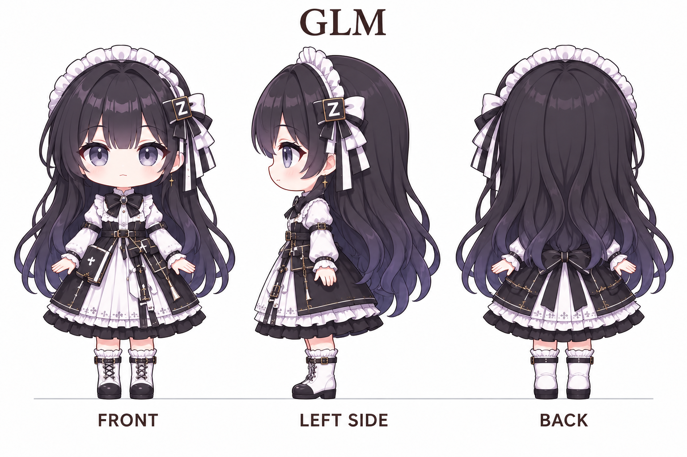

# 智谱 GLM

黑长发 · 黑白书卷装 · 认真呆萌。所属模型／产品：智谱；社区女性拟人形象。

## 独立动作关键帧

每一帧单独生成、对照与修正，共七张。保留小圆手与紧凑手臂；K3／K4 是腰胯转动，K5 双腿不交叉。

[逐帧浏览与制作记录](keyframes/v4-individual/README.md) · [独立帧浏览页](../../keyframes/index.html#glm)

## 版本

| 版本 | 图像尺寸 | PNG |
| --- | --- | --- |
| [初版](variants/v1-initial/) | 1536 × 1024 | [v1-initial](variants/v1-initial/sheet.png) |
| [参考图匹配版](variants/v2-dance/) | 1536 × 1024 | [v2-dance](variants/v2-dance/sheet.png) |

当前默认版本为 **参考图匹配版**，依据 [八人参考图](../../references/dance-reference-board.png) 中的 TOP ROW, FOURTH column。各版本并列保留；形象、服装与表情可有差异。

## 来源与署名

角色与服装参考：ZipZipPipe《大AI和小AI们》；截帧整理：shuaizenge/ai-girls；本次三视图：Codex 内置 imagegen 生成，侧背面为衍生推定。

[素材来源](https://github.com/shuaizenge/ai-girls/tree/main/characters/glm) · [原始发布／整理来源](https://www.bilibili.com/video/BV1tE9XBbErS/) · [逐项记录](provenance.json)

许可记录：参考仓库记录作者开放分享与再创作的说明，未核实统一标准许可证；生成不改变原角色权利状态。

当前系列使用内置 imagegen 参照补全，正／侧／背顺序一致；侧背面不可见结构为推定。图片许可不随代码 MIT 许可变更。详见 [图片许可](../../ASSET-LICENSES.md)。

[返回图鉴](../../README.md) · [在画廊浏览](../../index.html#glm/v2-dance)
