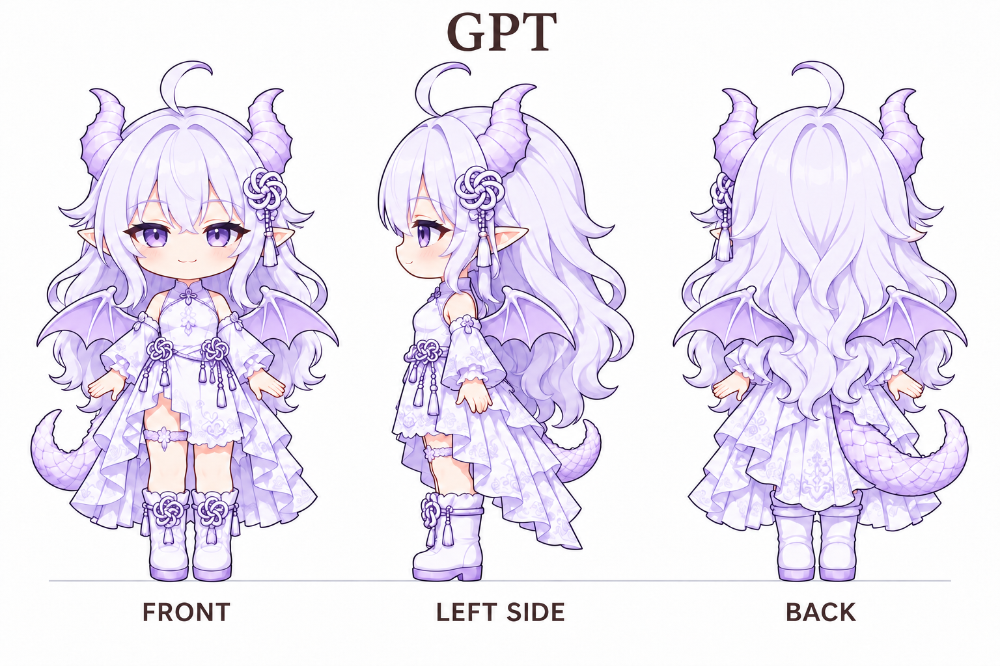

# ChatGPT / GPT

白紫龙娘 · 龙角龙翼龙尾 · 自信浅笑。所属模型／产品：OpenAI；社区女性拟人形象。

## 独立动作关键帧

每一帧单独生成、对照与修正，共七张。保留小圆手与紧凑手臂；K3／K4 是腰胯转动，K5 双腿不交叉。

[逐帧浏览与制作记录](keyframes/v4-individual/README.md) · [独立帧浏览页](../../keyframes/index.html#gpt)

## 版本

| 版本 | 图像尺寸 | PNG |
| --- | --- | --- |
| [初版](variants/v1-initial/) | 3348 × 2000 | [v1-initial](variants/v1-initial/sheet.png) |
| [初版 · 自然微笑修订](variants/v1-natural-smile/) | 1623 × 969 | [v1-natural-smile](variants/v1-natural-smile/sheet.png) |
| [参考图匹配版](variants/v2-dance/) | 1536 × 1024 | [v2-dance](variants/v2-dance/sheet.png) |

当前默认版本为 **参考图匹配版**，依据 [八人参考图](../../references/dance-reference-board.png) 中的 BOTTOM ROW, FIRST column。各版本并列保留；形象、服装与表情可有差异。

## 来源与署名

原始角色设计参考 ZipZipPipe 系列；此白紫龙娘变体原图作者未标注，收录署名“这个刀子真甜”不等同于作者。三视图整理补全：lmy414/ai-chan-sheets。

[素材来源](https://github.com/lmy414/ai-chan-sheets/tree/main/设定图/13_GPT娘_Q版白紫龙娘) · [原始发布／整理来源](https://xn--pssy23gqgbz2d718b.com/works/gpt202610310001.html) · [逐项记录](provenance.json)

许可记录：来源条目授权记录 unknown；整理仓库的声明不替代原作者授权。

当前系列使用内置 imagegen 参照补全，正／侧／背顺序一致；侧背面不可见结构为推定。图片许可不随代码 MIT 许可变更。详见 [图片许可](../../ASSET-LICENSES.md)。

[返回图鉴](../../README.md) · [在画廊浏览](../../index.html#gpt/v2-dance)
